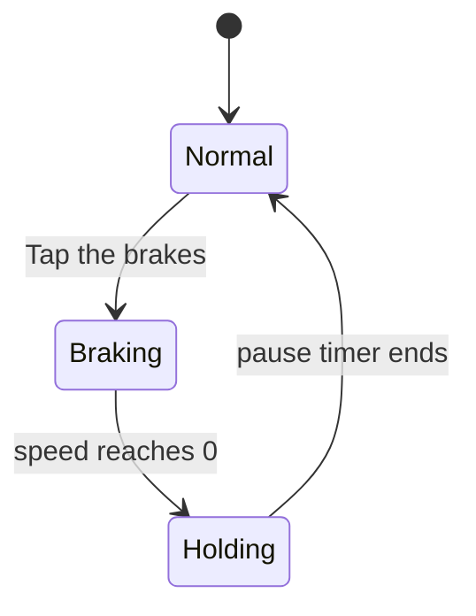
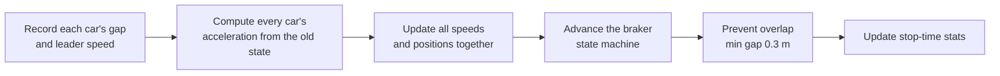

# Phantom Jam Lab

**Why traffic stops for no reason.** An interactive simulation of phantom traffic jams: one driver taps the brakes, everyone behind reacts a moment late, and the delay snowballs into a standing queue where each car waits longer than the one ahead of it.


---

## The idea

A lot of highway congestion has no accident, no lane closure and no bottleneck. It starts when one driver brakes a little too hard or pauses a little too long. The driver behind reacts after a delay, so they brake harder than the first driver did. The next driver does the same. The disturbance grows as it travels backward, and traffic ends up stopped far behind the original cause.

This project models that mechanism and lets you play with it:

- Add or remove cars while the simulation runs.
- Set how long the front car stays stopped.
- Change how quickly and how late drivers react.
- Turn on random slowdowns and watch a jam appear with no brake tap at all.

## What you can see

| View | What it shows |
|---|---|
| **Ring road** | Cars driving around a 0.6 mile loop, colored by speed. The braking car is outlined and labeled. |
| **Space-time diagram** | Every car's position over the last two minutes. Stopped queues appear as flat red bands that drift backward. |
| **Wait-time chart** | Longest unbroken stop for each car, counted back from the braker. This is where the "each car waits longer than the one ahead" effect becomes visible. |
| **Live stats** | Average speed, cars stopped, flow in cars per hour, longest wait, clock. |

## Quick start

No install, no build step, no server.

```bash
git clone https://github.com/YOUR-USERNAME/phantom-jam.git
cd phantom-jam
# then open index.html in any modern browser
```

Or just double-click `index.html`. It works offline. Fonts load from Google Fonts when online and fall back to system fonts when not.

**Browser support:** current Chrome, Edge, Firefox and Safari. The canvas drawing uses `roundRect` (Chrome 99+, Safari 16+, Firefox 112+).

## Controls

| Control | Effect |
|---|---|
| **Cars on the road** | Adds or removes cars live (8 to 60). Density is the biggest factor in whether a jam clears. |
| **Pause at the front** | Seconds the braking car stays stopped before pulling away (0 to 20). |
| **Tap the brakes** | Triggers the braking car: slow to a stop, hold, then go. |
| **Reaction time** | Delay before a driver reacts to the car ahead (0 to 1.2 s). |
| **Start-up lag** | How long a stopped driver waits after the car ahead moves (0 to 3 s). |
| **Random slowdowns** | Brief lifts off the gas, per car per minute (0 to 2). |
| **Scenarios** | One-click presets: light traffic, heavy traffic, perfect drivers, sleepy drivers, phantom jam with no braking. |
| **Playback** | Pause, speed up to x8, reset the road. |

## How the model works

### 1. Car following

Each car follows the one ahead using the **Intelligent Driver Model (IDM)**, a standard microscopic traffic model. A car's acceleration depends on its speed, the gap to the car ahead, and how fast it is closing in:

```
a = A * [ 1 - (v / v0)^4 - (s* / s)^2 ]
s* = s0 + max(0, v*T + v*dv / (2*sqrt(A*B)))
```

| Symbol | Meaning | Value used |
|---|---|---|
| `v0` | desired speed | 29 m/s (about 65 mph) |
| `T` | desired time gap | 1.4 s |
| `s0` | minimum gap when stopped | 2 m |
| `A` | comfortable acceleration | 1.2 m/s^2 |
| `B` | comfortable braking | 2.0 m/s^2 |

With IDM alone and no disturbance, traffic on the loop stays perfectly smooth. The flaws below are what create jams.

### 2. Human flaws

| Flaw | How it is modeled |
|---|---|
| **Reaction delay** | Each car keeps a ring buffer of recent observations and reacts to the gap and leader speed from `reaction time` seconds ago. |
| **Start-up lag** | A stopped car holds position until the car ahead has been moving for `lag` seconds. |
| **Over-braking** | Braking is scaled up by 30%, and the driver stays off the throttle briefly afterward. Fixed in the code, not exposed as a slider  |
| **Random slowdowns** | At random, a car brakes gently for 0.8 to 2.2 seconds. |
| **Driver variety** | Each car gets its own multiplier (about 0.75 to 1.25) on reaction time and lag so cars do not behave identically. |
| **Last-moment reflex** | If the real gap is closing too fast, the car brakes hard using the actual gap, ignoring the delay. This stops cars from passing through each other. |

### 3. The brake tap

Car 0 is the braker and runs a small state machine:



### 4. One simulation step (0.05 s)



All accelerations are computed before any car moves. Otherwise cars would react to positions that were already updated this step.

### 5. Rendering

- **Ring:** position becomes an angle, and each car is a rotated rectangle drawn to true scale along the road.
- **Space-time diagram:** every 0.25 s of simulated time, the canvas is copied 2 px to the left and one new column is drawn at the right edge. Old data is never redrawn.
- **Wait-time chart:** an SVG rebuilt a few times per second, colored through CSS variables so light and dark mode both work.
- **Clock:** a fixed time step with an accumulator, so physics is identical at every playback speed and on every screen.

## Findings

These came from running the simulation headless (seed 7, 0.05 s steps) while tuning the defaults.

- **The effect is real in the model.** After a brake tap, the longest stop grows by roughly 1 second for every car further back from the braker.
- **Density is decisive.** With about 12 to 18 cars on the loop, a brake tap causes a jam that clears on its own, and the pause length controls how big it gets. At 22 or more cars, a single stop leaves a jam that never clears. That is why the default is 18 cars.
- **Random slowdowns alone can start a jam.** With 40 cars and slowdowns on, a jam formed about 48 simulated seconds in with no brake tap.
- **Reaction time and start-up lag matter most.** Perfect drivers (almost no reaction time or lag) cleared a jam at 26 cars. Slow, late drivers did not clear one at 18.
- **An over-braking slider was dropped.** In testing, braking harder made jams smaller, not larger, so a slider would not have matched the idea behind it.
- **Reaction times above about 1.2 s cause near misses.** The slider is capped there.

These numbers describe this model with these parameters. They are not claims about real roads.

## Project structure

```
phantom-jam/
├── index.html    # the whole app: styles, simulation, rendering, controls
└── README.md
```

Inside `index.html`:

- First `<script>` block: the `Sim` module. Pure logic, no DOM. `create`, `step`, `tap`, `setCount`, `metrics`.
- Second `<script>` block: the UI. Canvas drawing, SVG chart, controls, preset buttons, the animation loop.

To change the traffic physics, edit the constants at the top of `Sim` (`IDM`, `CAR_LEN`, `L`, `STOP_V`).

## Customizing

| Want to change | Edit |
|---|---|
| Road length | `L` in `Sim` (meters). Re-tune car counts if you change it. |
| Speed limit or driving style | the `IDM` object |
| What counts as stopped | `STOP_V` (m/s) |
| Slider ranges and defaults | the `<input type="range">` elements |
| Preset scenarios | the `PRESETS` object in the UI script |
| Colors and fonts | the CSS variables at the top of the stylesheet |
| Speed color scale | `STOPS` and `VMAX` in the UI script |

## Testing the model without a browser

The `Sim` module has no DOM dependency, so you can extract it and run it in Node:

```js
const Sim = require('./sim.js'); // copy the Sim block into its own file with module.exports
const S = Sim.create(18, 7);
const P = { react: 0.8, over: 0.3, lag: 1.2, rand: 0, pause: 10 };
for (let i = 0; i < 4000; i++) {
  if (i === 40) Sim.tap(S);
  Sim.step(S, P);
}
console.log(Sim.metrics(S));
```

Building and tuning the model this way, before touching any visuals, is how the defaults in this project were chosen.

## Limitations

- One lane, one ring, identical cars. No lane changes, merging or overtaking.
- Driver variation is a simple random multiplier, not calibrated to real driver data.
- The model produces realistic qualitative behavior. It has not been calibrated against measured traffic.
- A 1 km loop is short. Real jams span kilometers.

## Roadmap ideas

- Multi-lane roads with lane changes
- On-ramps and merging traffic
- Adaptive cruise control cars mixed in, to test whether they dampen jams
- Export a run's data to CSV
- Shareable links that encode slider settings

## Deploy

To host it free on GitHub Pages:

1. Push the repo to GitHub with the app named `index.html` at the root.
2. Go to **Settings, Pages**.
3. Under **Build and deployment**, choose **Deploy from a branch**, select `main` and `/ (root)`, and save.
4. After a minute or two the site is live at `https://YOUR-USERNAME.github.io/REPO-NAME/`.

## References

- M. Treiber, A. Hennecke, D. Helbing. *Congested traffic states in empirical observations and microscopic simulations.* Physical Review E 62, 1805 (2000). The Intelligent Driver Model.
- Y. Sugiyama et al. *Traffic jams without bottlenecks: experimental evidence for the physical mechanism of the formation of a jam.* New Journal of Physics 10, 033001 (2008). The ring-road experiment that showed jams forming with no bottleneck.

